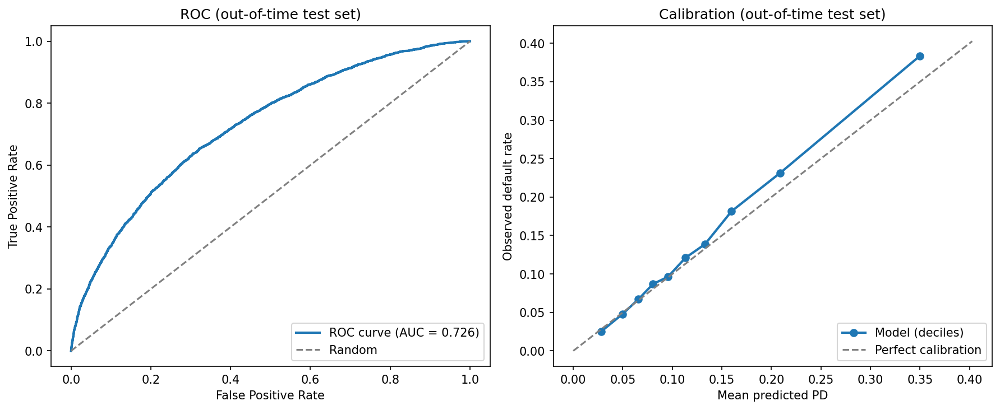

# Credit Risk Modelling: PD and LGD on Bondora P2P Loans

## Problem

A consumer lender needs two numbers for each loan to price it and to hold provisions against it:

* **PD (Probability of Default)**: the probability that a new applicant defaults within 12 months of the loan being issued. It is scored at application time, so the model uses only information available when the application is made.
* **LGD (Loss Given Default)**: the share of the exposure that is lost once a loan has defaulted, after recoveries. It is scored at the default date, so the model uses only information known at that point.

The data is Bondora's public loan book: about 330k peer-to-peer consumer loans issued between 2009 and 2023 in Estonia, Finland, Spain and Slovakia, with a snapshot date (`ReportAsOfEOD`) of 2023-10-15.

## Headline results

All numbers are on an **out-of-time** test set (the most recent 10% of loans by issue date for PD, and by default date for LGD). The pipelines write them to `models/metrics/*.json`.

**PD (XGBoost)**

| ROC AUC | Gini | KS | Brier | Test default rate | Mean predicted PD |
| :--- | :--- | :--- | :--- | :--- | :--- |
| 0.726 | 0.452 | 0.331 | 0.108 | 13.8% | 12.8% |

ROC AUC within each country: EE 0.708, FI 0.675, ES 0.629, NL 0.525 (NL has 174 test loans and does not appear in the training period).

The 5-fold cross-validated AUC within the training period is 0.792. The gap to 0.726 comes from moving to an out-of-time test. Loans in the test window (April to October 2022) defaulted at 13.8%, against about 30% for 2014–2019 vintages. Calibration still holds: the mean predicted PD is 12.8% against an observed 13.8%.



**LGD (CatBoost)**

| MAE | Baseline MAE (train mean) | RMSE | R² | Spearman | Pearson |
| :--- | :--- | :--- | :--- | :--- | :--- |
| 0.230 | 0.274 | 0.278 | 0.206 | 0.485 | 0.458 |

The test set has 7,401 defaults, with a mean realised LGD of 66%. Realised LGD is much harder to predict than PD: the distribution is bimodal (many loans recover almost nothing, others recover in full), and recovery depends heavily on collection outcomes after default. An R² of around 0.2 is typical for this kind of model. An earlier version of this project reported R² 0.84, but that came from predicting Bondora's own LGD estimate using balances measured after default.

## Modelling choices

### PD target and censoring
`DefaultTarget_12m = 1` if the loan defaulted within 365 days of `LoanDate`, otherwise 0. Loans issued less than 12 months before the snapshot date are dropped, because their 12-month outcome is not yet known. The observation window is measured against the data snapshot. It is not measured against scheduled dates such as `MaturityDate_Last`, which lie in the future.

### No leakage from preprocessing or time
* The imputer, log-transform caps and encoders are sklearn transformers, fitted on the training split only (`src/transformers.py`).
* The train/test split is out-of-time, not random.
* Training saves the fitted preprocessing and the model as a single `models/inference_pipeline.joblib`, and the API serves exactly that object.

### LGD target and features
Bondora's `LossGivenDefault` column is **not** used as the target. It is filled for non-defaulted loans too, so it is Bondora's own ex-ante estimate rather than an observed loss. The target is the realised loss instead:

`LGD = 1 - PrincipalRecovery / EAD1`, clipped to [0, 1]

It is computed over defaults with at least 24 months between the default date and the snapshot, so that recoveries are largely complete. Features are limited to application data plus exposure at default (`EAD1`, `EAD2`, months on book at default). Balances, recovery stage, servicing costs and late-payment categories are measured at the snapshot date, and including them would leak the outcome.

### Fair lending
**Gender is excluded** from both models. EU and US fair-lending rules restrict its use in credit decisions. **Age is still a feature.** Several jurisdictions allow age in empirically derived scoring systems under conditions, so check local rules before using this model for real lending decisions.

### Country dependence
Country and the closely linked application language are strong PD features. Spanish loans in the training period defaulted at 52%, against 15% in Estonia and 23% in Finland. Together they account for 42% of XGBoost's average split gain and 10% of total gain. The interest rate is the largest single feature by total gain, at 28%. Country is a real pattern in the Bondora book, but it means part of the overall AUC comes from separating countries rather than borrowers. The within-country AUCs above show how well the model ranks borrowers within a single market.

## Tools
* **[Prefect](https://www.prefect.io/)**: orchestrates the training and inference pipelines as flows and tasks.
* **[Hydra](https://hydra.cc/)**: configuration. You switch between PD and LGD and between pipelines from the CLI.
* **[MLflow](https://mlflow.org/)**: tracks parameters, CV metrics and out-of-time test metrics in a local SQLite database.
* **[Optuna](https://optuna.org/)**: hyperparameter search. Plots are saved in `models/optuna_plots/`.
* **[FastAPI](https://fastapi.tiangolo.com/)**: serves the PD pipeline as a REST API.
* **[uv](https://github.com/astral-sh/uv)**: dependency management.
* **XGBoost and CatBoost**: the PD and LGD models.

## Setup

1. Install [uv](https://github.com/astral-sh/uv) and sync the dependencies:
    ```bash
    uv sync --extra dev
    ```
2. Download the Bondora loan dataset from [Bondora public reports](https://www.bondora.com/en/public-reports) and save it as `data/raw_data/LoanData.csv` (`;`-separated).
3. (Optional) Start the Prefect UI with `uv run prefect server start`, then open http://localhost:4200.

## Running pipelines

```bash
# PD: target, out-of-time split, fit preprocessing + XGBoost, evaluate, save inference pipeline
uv run src/main.py project=pd_model project.pipeline=training

# PD: smoke-test the saved inference pipeline on raw rows
uv run src/main.py project=pd_model project.pipeline=inference

# LGD: realised-LGD target, out-of-time split, CatBoost, evaluate
uv run src/main.py project=lgd_model project.pipeline=training
```

`project=pd_model project.pipeline=training` is the default, so plain `uv run src/main.py` trains the PD model. Hydra lets you override any value in `config/`, for example `data.raw_data=./data/other.csv`.

Outputs:
* `models/inference_pipeline.joblib`: fitted preprocessing plus the PD model (this is what the API serves)
* `models/xgboost_model.joblib`, `models/catboost_regression_model.joblib`: the bare models
* `models/metrics/pd_metrics.json`, `models/metrics/lgd_metrics.json`: out-of-time test metrics
* `presentation/pd_evaluation.png`: ROC and calibration on the test set
* `models/interpretability/`: XGBoost feature importance and SHAP summary plots
* MLflow runs: `uv run mlflow ui --backend-store-uri sqlite:///mlflow.db`

## Serving the PD model

```bash
uv run uvicorn src.app:app --reload        # local
docker compose up --build                  # or in Docker
```

* Swagger UI: http://localhost:8000/docs
* Health check: http://localhost:8000/
* Postman: import `tests/Credit Risk ML FAST API.postman_collection.json`. It contains a health check plus a low-risk and a high-risk example applicant.

## Tests

```bash
uv run pytest
```

The tests use small synthetic data and cover these behaviours:
* PD target censoring
* ratio features keep their fractional values
* preprocessing state is learned only at fit time
* the column layout of API requests
* the realised-LGD target and the leakage-free LGD feature set

Pre-commit hooks (ruff, mypy) are configured in `.pre-commit-config.yaml`. Enable them with `uv run pre-commit install`.

## Further analysis
`presentation/interpretability_pd.ipynb` contains feature-importance and SHAP analysis of the PD model.

## Future improvements
1. **Feature expansion**: add variables such as occupation, and build features for non-linear effects.
2. **Model registry**: use the MLflow model registry for versioning and promotion, instead of joblib files.
3. **CI/CD**: run the tests and a Docker build in GitHub Actions.
4. **Monotonic constraints**: constrain features where the direction of risk is known, for example income.
5. **LGD workout modelling**: model recoveries over time instead of excluding defaults with short workout periods.
6. **Natural-language explanations**: turn SHAP output into explanations for non-technical stakeholders.
